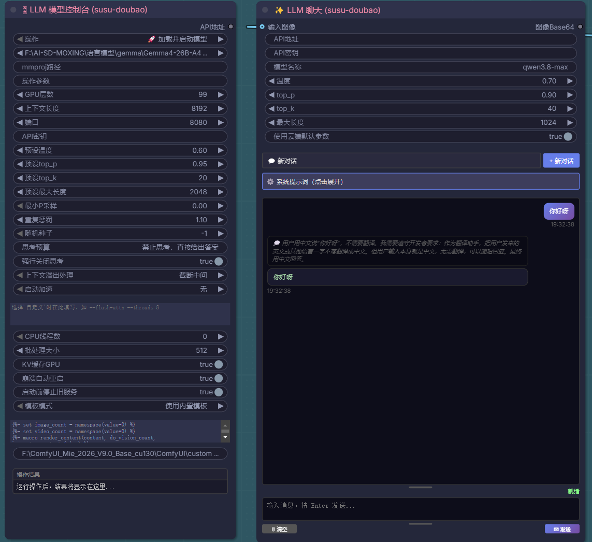

# susu-doubao — ComfyUI 本地大模型聊天插件

> 内置 llama.cpp 的 ComfyUI 本地大模型插件，支持本地 GGUF 模型和云端 OpenAI 格式 API，带流式对话前端界面。

## ✨ 功能特点

- **🎛 LLM 模型控制台**：一键启动 llama-server，加载 GGUF 模型，可调 GPU 层数、上下文长度、端口、API 密钥
- **💬 LLM 聊天节点**：支持本地 llama.cpp 和云端 OpenAI 格式 API，带完整的流式对话前端界面
- **🌊 流式输出**：实时显示生成内容，支持停止生成
- **🔄 多轮会话**：支持会话 ID 管理，可清除历史
- **🖼 视觉模型支持**：支持输入图像，让视觉模型（如 Qwen-VL、LLaVA 等）分析图片
- **📋 预设系统**：内置创意写作、精确回答、代码助手、画图 Prompt 等预设，支持自定义
- **🔧 丰富参数**：温度、top_p、top_k、max_tokens、重复惩罚、min_p 等完整参数调节
- **🔑 API 密钥支持**：本地模型可设 API 密钥保护，云端模型直接填密钥
- **📊 Token 统计**：显示生成 token 数、生成速度

## 🖼 节点预览

插件包含两个节点：LLM 模型控制台和 LLM 聊天节点



## 📦 安装方法

### 方式一：Git Clone

```bash
cd ComfyUI/custom_nodes
git clone https://github.com/你的用户名/susu-doubao.git
```

### 方式二：下载 ZIP

1. 下载仓库 ZIP 包
2. 解压到 `ComfyUI/custom_nodes/susu-doubao/` 目录
3. 重启 ComfyUI

### 关于 llama.cpp 运行库（bin 目录）

本插件需要 `llama-server.exe` 才能运行本地模型。由于 bin 目录约 2GB，不包含在 Git 仓库中，你有两种方式获取：

**方式 A：使用插件内置的 bin 目录（推荐）**

1. 从 [llama.cpp 官方发布页](https://github.com/ggerganov/llama.cpp/releases) 下载最新的 Windows CUDA 版本（如 `llama-bXXXX-bin-win-cuda-cu12-x64.zip`）
2. 解压后把所有 DLL 和 EXE 文件放到插件的 `bin/` 目录下
3. 确保 `bin/llama-server.exe` 存在

**方式 B：使用你已有的 llama-server.exe**

在节点的 `llama_server_path` 参数中直接填写你本机的 llama-server.exe 完整路径即可。

> 注意：bin 目录中的 `bin/bin/` 子目录是冗余的，可以删除，不影响功能。

## 🚀 使用方法

### 基本工作流

1. 在 ComfyUI 节点搜索框输入 `susu-doubao` 或 `LLM` 找到节点
2. 拖入「🎛 LLM 模型控制台」节点，选择 GGUF 模型，设置参数
3. 拖入「💬 LLM 聊天」节点，把控制台的 `model` 输出连到聊天节点的 `model` 输入
4. 填写用户消息，运行工作流
5. 聊天节点的 `response` 输出可以直接连到 CLIP Text Encode 当画图 prompt 用

### 使用云端 API（不启动本地模型）

LLM 聊天节点也支持直接连接云端 OpenAI 格式 API：

1. 不需要拖入模型控制台节点
2. 在聊天节点中填写：
   - `API地址`：如 `https://api.openai.com/v1` 或其他兼容地址
   - `API密钥`：你的 API Key
   - `模型名称`：如 `gpt-4o`、`doubao-pro` 等
3. 填写用户消息，运行即可

## 📝 节点参数说明

### 🎛 LLM 模型控制台

| 参数 | 默认值 | 说明 |
|------|--------|------|
| 模型路径 | — | GGUF 模型文件路径，自动扫描 ComfyUI/models/LLM 和 ~/llama.cpp/models 目录 |
| n_gpu_layers | 99 | GPU 层数，99=全部放 GPU，CPU 推理设为 0 |
| n_ctx | 4096 | 上下文长度（token），越大越占显存 |
| 端口 | 8080 | 服务端口，0=自动选择空闲端口 |
| API密钥 | 空 | 设置后访问 API 需要密钥，留空=不设密钥 |
| llama_server_path | 插件bin目录 | llama-server.exe 路径，可自定义 |
| extra_args | 空 | 额外启动参数，如 `--flash-attn` |
| 操作 | 无操作 | 可选择停止指定端口的服务 |
| 操作参数 | — | 操作对应的参数（如端口号） |

### 💬 LLM 聊天

| 参数 | 默认值 | 说明 |
|------|--------|------|
| model | — | 连接模型控制台的输出，使用云端 API 时可不连 |
| 用户消息 | — | 你要发送的消息 |
| 系统提示词 | 空 | 系统级提示词，定义 AI 行为 |
| 温度 | 0.7 | 0-2，越高越随机，越低越确定 |
| top_p | 0.9 | 核采样，0-1，建议 0.8-0.95 |
| top_k | 40 | 只从概率最高的前 K 个 token 中选，0=禁用 |
| 最大长度 | 1024 | 模型单次回复最大 token 数 |
| 重复惩罚 | 1.1 | 重复 token 惩罚，1.0=禁用 |
| 最小P采样 | 0.0 | 最小概率采样，0=禁用 |
| 会话ID | 空 | 留空=单轮对话，填写后开启多轮会话 |
| 清除历史 | 否 | 是=清除当前会话历史 |
| API地址 | http://127.0.0.1:8080/v1 | 云端 API 地址，本地模型自动获取 |
| API密钥 | 空 | 云端 API 密钥 |
| 模型名称 | 空 | 云端模型名称，本地模型自动获取 |
| 使用云端默认参数 | 否 | 开启后不传递温度等参数，让云端用默认值 |
| 输入图像 | — | 可选，视觉模型分析图片 |

## 🧠 支持的模型格式

- **GGUF**：llama.cpp 标准格式，支持所有主流开源模型
  - Qwen / Qwen2 / Qwen2.5 / Qwen3 系列
  - Llama 3 / Llama 3.1 / Llama 3.2 系列
  - Mistral / Mixtral 系列
  - Phi-3 / Phi-4 系列
  - Gemma / Gemma 2 系列
  - DeepSeek 系列
  - 以及所有其他 GGUF 格式模型
- **视觉模型**：支持多模态 GGUF 模型（如 Qwen-VL、LLaVA、Moondream 等），需要配套 mmproj 文件
- **云端 API**：支持所有 OpenAI 格式的云端 API（OpenAI、Anthropic（兼容格式）、豆包、通义千问、Kimi、DeepSeek 等）

## 💻 系统要求

- **操作系统**：Windows 10/11（本插件内置 Windows 版 llama.cpp）
- **显卡**：NVIDIA GPU 推荐（支持 CUDA 加速），AMD/Intel 显卡或纯 CPU 也可运行但速度较慢
- **显存**：根据模型大小而定，7B 模型 4-bit 量化约需 5-6GB 显存
- **内存**：建议 16GB 以上
- **ComfyUI**：最新版本即可，无需额外 Python 依赖

## ❓ 常见问题

**Q: 启动后提示找不到 llama-server.exe？**
A: 请确保 bin 目录下有 llama-server.exe，或在节点中手动指定 llama_server_path 路径。

**Q: 模型列表是空的？**
A: 把 GGUF 模型放到 `ComfyUI/models/LLM/` 目录下，或修改 `__init__.py` 中的 `DEFAULT_MODEL_DIR` 为你的模型目录。

**Q: 端口被占用怎么办？**
A: 把端口设为 0 会自动选择空闲端口，或手动改一个其他端口号。

**Q: 多个模型能同时跑吗？**
A: 可以，用多个模型控制台节点，每个设不同端口即可。注意显存占用。

**Q: 流式生成怎么停止？**
A: 在模型控制台节点的「操作」中选择「停止服务」，填写对应端口号，运行即可。

**Q: 支持 Mac/Linux 吗？**
A: 目前 bin 目录只包含 Windows 版 llama.cpp。Mac/Linux 用户可以自行编译 llama.cpp，然后在节点中指定 llama_server_path 路径。

**Q: 插件会自动关闭 llama-server 吗？**
A: 不会自动关闭，关闭 ComfyUI 时会自动清理进程。也可以手动用停止操作关闭。

## 📄 开源协议

MIT License

Copyright (c) 2026 素素（Susu）

## 🙏 致谢

- [llama.cpp](https://github.com/ggerganov/llama.cpp)：本地大模型推理引擎
- [ComfyUI](https://github.com/comfyanonymous/ComfyUI)：强大的节点式 AI 绘图工具
- 所有开源模型的开发者和社区
